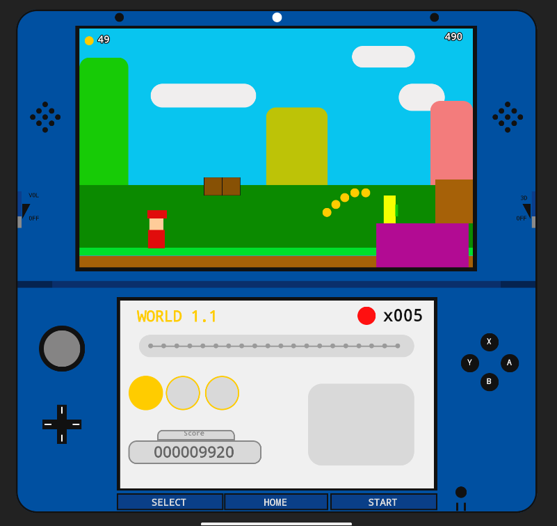

# 3DS

Maqueta de una consola Nintendo 3DS dibujada 100 % con **Jetpack Compose** (Kotlin) para Android, sin imágenes ni recursos gráficos externos: todo el aspecto de la consola, las dos pantallas y los botones se genera con código.

## Proceso: del diseño al código

1. **Diseño en Figma.** Antes de escribir código dibujé la consola completa en Figma: carcasa azul, pantalla superior con una escena estilo plataformas (monedas, bloques, personaje y nubes), pantalla inferior con el menú (mundo, vidas, marcador y barra de progreso), cruceta, botones X/Y/A/B y los botones SELECT / HOME / START.
2. **Medidas y colores.** Del diseño saqué posiciones, tamaños y paleta de colores (azul, amarillo, marrón, gris…) para trasladarlos tal cual.
3. **Traducción a Compose.** Cada zona del diseño pasó a ser un componente `@Composable` independiente, y todo está colocado con las coordenadas del lienzo de Figma (746 × 720).
4. **Pruebas en distintos tamaños.** Con `@Preview` y ejecutando en móvil y tablet comprobé que el resultado fuera fiel al diseño original.

## Cómo funciona el código

- `MainActivity.kt`: punto de entrada, activa pantalla completa y muestra `Game()`.
- `ui/theme/game/game.kt`: toda la consola.
  - **Unidad de escala `u`:** se calcula a partir del espacio disponible (`BoxWithConstraints`), de modo que el diseño se escala sin deformarse en cualquier pantalla.
  - **Piezas base reutilizables:** `Rectangulo`, `Circulo` y `Texto` colocan cualquier elemento por posición y tamaño usando las medidas del diseño.
  - **Composables por zona:** `Cabecera`, `Altavoz`, `PantallaSuperior`, `Escena`, `Bisagra`, `PantallaInferior` y `Controles`.
- `ui/theme/`: tema de Material 3 generado por Android Studio (`Color.kt`, `Theme.kt`, `Type.kt`).

## Tecnologías

Kotlin · Jetpack Compose · Material 3 · Gradle (Kotlin DSL) · Android Studio · Figma

## Ejecutar el proyecto

1. Clona el repositorio y ábrelo con Android Studio.
2. Sincroniza Gradle.
3. Ejecuta la app en un emulador o dispositivo Android.
